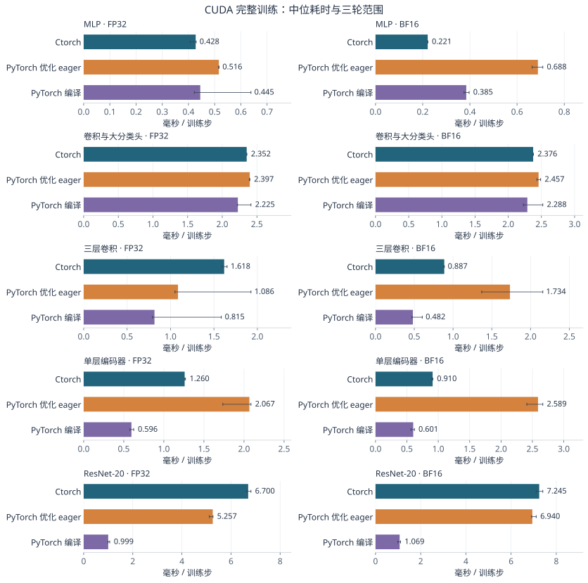
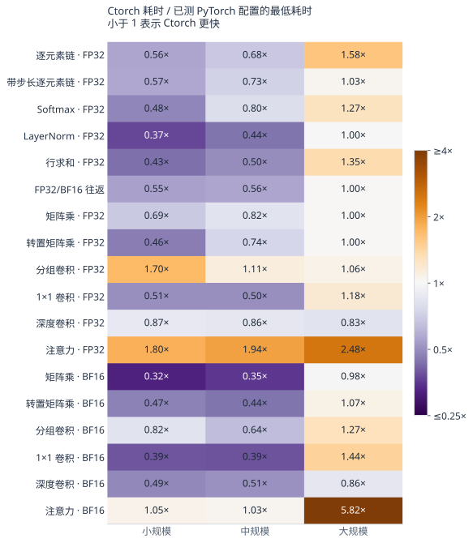
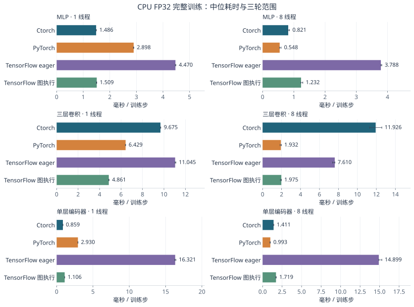

# Ctorch 与 PyTorch、TensorFlow 的多维性能比较

本页测量使用基础算子组合的 BatchNorm 与独立归一化梯度缓冲。当前通道归约实现的完整训练、显存和编码器数值分析见[归一化与完整训练](normalization.md)。两页各自使用同组测量中的数据。

比较范围包括 CUDA 算子、五种网络的推理与完整训练、低精度计算、显存、首次调用，以及三个框架的 CPU 执行。62 个 CUDA 算子场景、47 个 CUDA 模型场景和 12 个 CPU 场景分别测量三轮，共 1,149 次独立进程测量。另用 6 次测量比较首次模型调用。

模型训练步包含清空梯度、前向、平均交叉熵、反向传播和参数更新。计时使用固定输入重复训练，输入已在计算设备上。数据读取、增强、文件保存和设备间传输不在计时范围内。数据集上的准确率与收敛结果见[框架结果对比](comparison.md)。

## 主要结果

- 较大批量的 BF16 MLP 完整训练，Ctorch 为 0.221 ms，PyTorch 编译配置为 0.385 ms，Ctorch 耗时低约 42.5%。
- 三层卷积、默认注意力编码器和 ResNet-20 的 BF16 训练，Ctorch 耗时分别为 PyTorch 编译配置的 1.84、1.52 和 6.78 倍。大分类头模型的耗时接近。
- 推理中的权重缓存和注意力后端会改变结果。下面分别列出这些配置，并保留 Ctorch 默认实现的耗时。
- BF16 不会让所有模型都更快。低精度计算之外，布局转换、归一化、激活和参数更新仍然需要执行。

## 硬件与执行配置

| 项目 | 配置 |
| --- | --- |
| GPU | NVIDIA GeForce RTX 5090 Laptop GPU，24 GB |
| CPU | Intel Core Ultra 9 275HX |
| 系统 | Windows 11 |
| Ctorch CUDA | C++20 Release，MSVC 19.50，CUDA 13.2 编译工具、13.4 运行库，cuDNN 9.21 |
| Ctorch CPU | GCC 16.1 Release，OpenBLAS 0.3.34 |
| PyTorch | 2.11.0+cu128，cuDNN 9.19，Python 3.14，Triton Windows 3.6 |
| TensorFlow | 2.20.0，Python 3.12，CPU oneDNN |

FP32 计算关闭 TF32。BF16 与 FP16 使用 autocast，主参数和优化器状态保持 FP32。Ctorch 的低精度算子返回 FP32 激活，PyTorch 在部分算子之间保留低精度激活，因此两边的激活存储和舍入位置不同。

GPU 测量固定宿主提交线程，PyTorch 算子内与算子间线程数均为 1。每个算子先调用一次，再预热 30 次，测量 7 组、每组 30 次；模型预热 60 次，测量 7 组、每组 10 次。每种配置运行三轮并轮换顺序，表中取三轮中位数。图中的误差线表示三轮中位耗时的最小值与最大值。部分短调用的进程间波动较大，完整测量表同时保留最小值与最大值。

宿主计时包含调用提交和等待 GPU 完成。另记录同一计算流上的 CUDA Event 时间。Event 区间也可能包含 GPU 等待宿主提交的间隔，不能用两种计时之差表示全部 CPU 开销。预热和同步的使用方法见 [PyTorch 测量教程](https://docs.pytorch.org/tutorials/recipes/recipes/benchmark.html)。

TensorFlow 在这里参与 CPU 比较。TensorFlow 2.20 的原生 Windows 包没有 CUDA 后端，GPU 环境需要 Linux 或 WSL2，见[官方安装说明](https://www.tensorflow.org/install/pip)。

## 对照框架的配置

| 配置 | 执行方式 |
| --- | --- |
| Ctorch | 普通 C++ eager 调用，使用 CUDA 内存池；CPU 使用 `MemoryGuard` 与 OpenBLAS |
| Ctorch cuDNN 注意力 | 为低精度注意力显式选择 cuDNN 后端，其他算子保持不变 |
| PyTorch eager | 原生 eager 算子，卷积使用 NCHW，注意力按矩阵乘与 Softmax 计算 |
| PyTorch 优化 eager | 融合优化器，cuDNN 算法选择，低精度卷积使用 `channels_last`，注意力使用 SDPA |
| PyTorch 编译 | 在优化 eager 上使用 `torch.compile(fullgraph=True, mode="reduce-overhead")`；编译前向与损失，通过 AOTAutograd 生成反向，优化器单独使用融合实现 |
| PyTorch AMP 缓存 | 只用于低精度推理，在连续调用外保留同一个 autocast 作用域，使用 `no_grad` 复用转换后的权重 |
| TensorFlow eager / 图执行 | 相同模型分别使用 eager 和 `tf.function`；图执行包含整个训练步，没有启用 XLA |

模型比较覆盖优化 eager、编译和适用的 AMP 缓存配置。算子比较保留普通 eager，并为逐元素链、Softmax、LayerNorm 增加编译配置，为卷积、注意力与优化器增加相应优化配置。表中的“最快 PyTorch”表示这些已测配置中的最低耗时。

PyTorch 的 AMP 权重缓存要求权重不变，并保留 autocast 作用域；这里使用 `no_grad`，因为所测版本的 `inference_mode` 不使用这条缓存路径。条件见 [PyTorch 2.11 的 autocast 实现](https://github.com/pytorch/pytorch/blob/v2.11.0/aten/src/ATen/autocast_mode.cpp)。训练时每一步结束 autocast 作用域，以便下一步读取更新后的参数。

## CUDA 模型

| 模型 | 较大批量与结构 | 优化器 |
| --- | --- | --- |
| MLP | 批量 256；`1024 → 2048 → 1000`，ReLU | SGD，学习率 0.001，动量 0.9 |
| 卷积与大分类头 | 批量 32；`3×64×64` 输入，32 通道 3×3 卷积，ReLU，平均池化，`32768 → 1000` 分类层 | AdamW，学习率 0.001，权重衰减 0.01 |
| 三层卷积 | 批量 32；`3×64×64` 输入，通道 `3 → 32 → 64 → 64`，ReLU、平均池化、全局平均池化，1000 类 | AdamW，同上 |
| 单层编码器 | 批量 8，长度 128，宽度 256，8 个头，前馈宽度 1024，输出 512 类 | AdamW，同上 |
| ResNet-20 | 批量 8；`3×32×32` 输入，残差模块和 BatchNorm，10 类 | SGD，学习率 0.001，动量 0.9 |

每个模型另测批量 1。卷积使用步长 1、padding 1；编码器使用前置 LayerNorm、GELU、独立 Q/K/V 投影，关闭 Dropout。ResNet 训练更新 BatchNorm 的统计量，推理使用保存的统计量。

AdamW 的 `beta1=0.9, beta2=0.999, epsilon=1e-8`。SGD 不使用权重衰减或 Nesterov 动量。

各框架使用相同输入和参数初值。ResNet 使用教程中已训练的权重及 4 张 CIFAR-10 测试图像，批量 8 时重复这 4 张图像。其他模型使用确定性合成输入与初值。

## CUDA 完整训练

表中单位为毫秒 / 训练步，使用上表的较大批量。最后一列为 Ctorch 耗时除以已测 PyTorch 配置中的最低耗时，小于 1 表示 Ctorch 更快。

编码器在固定合成输入下连续训练 131 步后，FP32 损失与 PyTorch 两种配置相差约 3.6%–5.2%，超出设定容差；BF16 批量 1 也出现损失偏差。相应耗时可用于分析执行成本，数值差异与随机输入的补充检查见下文“数值比较”。

### FP32

| 模型 | Ctorch | PyTorch 优化 eager | PyTorch 编译 | 耗时比 |
| --- | ---: | ---: | ---: | ---: |
| MLP | 0.428 | 0.516 | 0.445 | 0.96× |
| 卷积与大分类头 | 2.352 | 2.397 | 2.225 | 1.06× |
| 三层卷积 | 1.618 | 1.086 | 0.815 | 1.98× |
| 单层编码器 | 1.260 | 2.067 | 0.596 | 2.11× |
| ResNet-20 | 6.700 | 5.257 | 0.999 | 6.70× |

### BF16

| 模型 | Ctorch | PyTorch 优化 eager | PyTorch 编译 | 耗时比 |
| --- | ---: | ---: | ---: | ---: |
| MLP | 0.221 | 0.688 | 0.385 | 0.58× |
| 卷积与大分类头 | 2.376 | 2.457 | 2.288 | 1.04× |
| 三层卷积 | 0.887 | 1.734 | 0.482 | 1.84× |
| 单层编码器 | 0.910 | 2.589 | 0.601 | 1.52× |
| ResNet-20 | 7.245 | 6.940 | 1.069 | 6.78× |



### BF16 训练吞吐

| 模型 | 计数单位 | Ctorch / 秒 | PyTorch 优化 eager / 秒 | PyTorch 编译 / 秒 |
| --- | ---: | ---: | ---: | ---: |
| MLP | 样本 | 1,157,010 | 371,893 | 665,436 |
| 卷积与大分类头 | 样本 | 13,471 | 13,023 | 13,987 |
| 三层卷积 | 样本 | 36,077 | 18,450 | 66,429 |
| 单层编码器 | token | 1,124,756 | 395,451 | 1,704,196 |
| ResNet-20 | 样本 | 1,104 | 1,153 | 7,485 |

## 小批量延迟

下面使用批量 1。推理关闭梯度，训练仍执行全部参数更新。单位为毫秒 / 调用。

| 模型 | 模式 | 精度 | Ctorch | 最快 PyTorch | PyTorch 配置 |
| --- | ---: | ---: | ---: | ---: | ---: |
| MLP | 推理 | FP32 | 0.029 | 0.076 | PyTorch 编译 |
| MLP | 推理 | BF16 | 0.046 | 0.075 | PyTorch 编译 |
| MLP | 训练 | FP32 | 0.139 | 0.417 | PyTorch 编译 |
| MLP | 训练 | BF16 | 0.166 | 0.392 | PyTorch 编译 |
| 卷积与大分类头 | 推理 | FP32 | 0.183 | 0.175 | PyTorch 编译 |
| 卷积与大分类头 | 推理 | BF16 | 0.324 | 0.174 | PyTorch AMP 缓存 |
| 卷积与大分类头 | 训练 | FP32 | 1.932 | 1.950 | PyTorch 优化 eager |
| 卷积与大分类头 | 训练 | BF16 | 2.008 | 2.106 | PyTorch 编译 |
| 三层卷积 | 推理 | FP32 | 0.163 | 0.076 | PyTorch 编译 |
| 三层卷积 | 推理 | BF16 | 0.167 | 0.077 | PyTorch 编译 |
| 三层卷积 | 训练 | FP32 | 0.435 | 0.472 | PyTorch 编译 |
| 三层卷积 | 训练 | BF16 | 0.485 | 0.532 | PyTorch 编译 |
| 单层编码器 | 推理 | FP32 | 0.222 | 0.080 | PyTorch 编译 |
| 单层编码器 | 推理 | BF16 | 0.257 | 0.082 | PyTorch 编译 |
| 单层编码器 | 训练 | FP32 | 0.753 | 0.585 | PyTorch 编译 |
| 单层编码器 | 训练 | BF16 | 0.751 | 0.564 | PyTorch 编译 |
| ResNet-20 | 推理 | FP32 | 2.192 | 0.286 | PyTorch 编译 |
| ResNet-20 | 推理 | BF16 | 2.437 | 0.129 | PyTorch 编译 |
| ResNet-20 | 训练 | FP32 | 6.260 | 1.023 | PyTorch 编译 |
| ResNet-20 | 训练 | BF16 | 6.795 | 1.047 | PyTorch 编译 |

## 低精度推理与权重缓存

使用较大批量，单位为毫秒 / 前向。AMP 缓存只复用权重转换结果，每次调用仍执行模型计算。FP16 仅测推理；训练表包含 FP32 和 BF16。

| 模型 | 精度 | Ctorch | PyTorch 优化 eager | PyTorch AMP 缓存 | PyTorch 编译 |
| --- | ---: | ---: | ---: | ---: | ---: |
| MLP | BF16 | 0.054 | 0.154 | 0.122 | 0.081 |
| MLP | FP16 | 0.054 | 0.160 | 0.112 | 0.087 |
| 卷积与大分类头 | BF16 | 0.447 | 0.408 | 0.202 | 0.359 |
| 卷积与大分类头 | FP16 | 0.416 | 0.381 | 0.184 | 0.338 |
| 三层卷积 | BF16 | 0.308 | 0.355 | 0.275 | 0.128 |
| 三层卷积 | FP16 | 0.276 | 0.350 | 0.267 | 0.105 |
| 单层编码器 | BF16 | 0.284 | 0.614 | 0.491 | 0.104 |
| 单层编码器 | FP16 | 0.288 | 0.648 | 0.529 | 0.179 |
| ResNet-20 | BF16 | 2.444 | 2.263 | 2.111 | 0.139 |
| ResNet-20 | FP16 | 2.371 | 1.921 | 1.636 | 0.136 |

带有大分类层的模型需要转换更多权重。将转换后的权重保留在多个推理调用之间，可以减少重复读写。训练中的参数每步都在变化，不能直接沿用同样的缓存方式。

## 注意力后端与序列长度

固定批量 8，将编码器长度从 128 增至 512。这里同时列出 Ctorch 默认注意力和显式 cuDNN 注意力，使用 BF16，单位为毫秒 / 调用。

| 长度 | 模式 | Ctorch 默认 | Ctorch cuDNN | PyTorch 优化 eager | PyTorch 编译 | PyTorch AMP 缓存 |
| --- | ---: | ---: | ---: | ---: | ---: | ---: |
| 128 | 推理 | 0.284 | 0.239 | 0.614 | 0.104 | 0.491 |
| 128 | 训练 | 0.910 | 0.887 | 2.589 | 0.601 | — |
| 512 | 推理 | 1.055 | 0.409 | 0.600 | 0.252 | 0.481 |
| 512 | 训练 | 2.670 | 1.476 | 2.676 | 0.876 | — |

默认数学注意力显式计算注意力分数和 Softmax。cuDNN 注意力与 PyTorch SDPA 可以使用融合实现，减少中间结果；完整编码器还包含投影、归一化、激活、残差和参数更新。

`TransformerEncoderLayer` 可以直接选择注意力后端：

```cpp
dl::nn::TransformerEncoderLayer encoder(256, 8, 1024, 0.0);
encoder.set_attention_backend(dl::AttentionBackend::cudnn);
```

上述低精度测量将模型和输入放在 CUDA 设备，并在 `AutocastGuard` 作用域内执行。

## CUDA 算子与规模

| 负载 | 小规模 | 中规模 | 大规模 |
| --- | --- | --- | --- |
| 逐元素、归一化、行求和、转换 | `64×256` | `1024×1024` | `4096×4096` |
| 矩阵乘 M×K×N | `64×128×96` | `512×512×512` | `2048×2048×2048` |
| 卷积 B×Cin×Cout×边长 | `4×8×16×16` | `8×32×64×32` | `16×64×128×64` |
| 注意力 B×H×T×D | `2×2×32×16` | `4×4×128×32` | `8×8×512×64` |

逐元素链为 `relu((x+bias)*0.5)`，带步长版本每隔一个元素读取一次。转置矩阵乘同时使用两个转置视图。分组卷积使用 3×3 核、2 组；1×1 卷积使用 1 组；深度卷积使用 3×3 核且 `Cout=Cin`。注意力没有掩码或 Dropout。

逐元素、Softmax、LayerNorm 和求和使用 FP32。转换算子单独测量 FP32 → BF16 → FP32。矩阵乘、卷积和注意力分别测 FP32 与 BF16 autocast。



<details>
<summary>全部算子耗时（微秒 / 调用）</summary>

| 算子 | 规模 | 精度 | Ctorch | PyTorch eager | PyTorch 优化 | PyTorch 编译 | Ctorch cuDNN |
| --- | ---: | ---: | ---: | ---: | ---: | ---: | ---: |
| 逐元素链 | 小 | FP32 | 25.83 | 46.20 | — | 69.06 | — |
| 逐元素链 | 中 | FP32 | 32.40 | 47.38 | — | 70.77 | — |
| 逐元素链 | 大 | FP32 | 532.58 | 518.11 | — | 337.66 | — |
| 带步长逐元素链 | 小 | FP32 | 24.90 | 43.81 | — | 82.96 | — |
| 带步长逐元素链 | 中 | FP32 | 34.13 | 46.89 | — | 81.58 | — |
| 带步长逐元素链 | 大 | FP32 | 608.32 | 593.17 | — | 785.48 | — |
| Softmax | 小 | FP32 | 8.25 | 17.22 | — | 67.86 | — |
| Softmax | 中 | FP32 | 13.27 | 16.67 | — | 68.07 | — |
| Softmax | 大 | FP32 | 215.83 | 170.46 | — | 332.61 | — |
| LayerNorm | 小 | FP32 | 8.60 | 23.19 | — | 67.24 | — |
| LayerNorm | 中 | FP32 | 10.73 | 24.32 | — | 68.88 | — |
| LayerNorm | 大 | FP32 | 173.05 | 173.66 | — | 332.62 | — |
| 行求和 | 小 | FP32 | 8.23 | 19.14 | — | — | — |
| 行求和 | 中 | FP32 | 9.68 | 19.51 | — | — | — |
| 行求和 | 大 | FP32 | 37.34 | 27.69 | — | — | — |
| FP32/BF16 往返 | 小 | FP32 | 16.43 | 30.01 | — | — | — |
| FP32/BF16 往返 | 中 | FP32 | 16.94 | 30.09 | — | — | — |
| FP32/BF16 往返 | 大 | FP32 | 244.98 | 244.83 | — | — | — |
| 矩阵乘 | 小 | FP32 | 21.51 | 31.34 | — | — | — |
| 矩阵乘 | 小 | BF16 | 18.54 | 58.11 | — | — | — |
| 矩阵乘 | 中 | FP32 | 23.96 | 29.05 | — | — | — |
| 矩阵乘 | 中 | BF16 | 21.57 | 61.10 | — | — | — |
| 矩阵乘 | 大 | FP32 | 532.14 | 530.40 | — | — | — |
| 矩阵乘 | 大 | BF16 | 213.62 | 217.74 | — | — | — |
| 转置矩阵乘 | 小 | FP32 | 12.21 | 26.35 | — | — | — |
| 转置矩阵乘 | 小 | BF16 | 27.34 | 58.33 | — | — | — |
| 转置矩阵乘 | 中 | FP32 | 21.92 | 29.42 | — | — | — |
| 转置矩阵乘 | 中 | BF16 | 26.62 | 60.05 | — | — | — |
| 转置矩阵乘 | 大 | FP32 | 531.86 | 531.44 | — | — | — |
| 转置矩阵乘 | 大 | BF16 | 233.39 | 217.63 | — | — | — |
| 分组卷积 | 小 | FP32 | 67.85 | 53.64 | 39.86 | — | — |
| 分组卷积 | 小 | BF16 | 72.29 | 87.75 | 96.45 | — | — |
| 分组卷积 | 中 | FP32 | 83.17 | 74.64 | 91.99 | — | — |
| 分组卷积 | 中 | BF16 | 74.60 | 127.62 | 116.59 | — | — |
| 分组卷积 | 大 | FP32 | 471.79 | 468.49 | 444.15 | — | — |
| 分组卷积 | 大 | BF16 | 259.79 | 213.82 | 203.81 | — | — |
| 1×1 卷积 | 小 | FP32 | 20.39 | 40.35 | 40.56 | — | — |
| 1×1 卷积 | 小 | BF16 | 34.32 | 89.95 | 87.25 | — | — |
| 1×1 卷积 | 中 | FP32 | 19.80 | 39.48 | 39.99 | — | — |
| 1×1 卷积 | 中 | BF16 | 35.33 | 92.09 | 91.38 | — | — |
| 1×1 卷积 | 大 | FP32 | 143.93 | 124.59 | 122.41 | — | — |
| 1×1 卷积 | 大 | BF16 | 121.71 | 84.62 | 85.82 | — | — |
| 深度卷积 | 小 | FP32 | 19.61 | 23.02 | 22.55 | — | — |
| 深度卷积 | 小 | BF16 | 32.45 | 66.54 | 88.24 | — | — |
| 深度卷积 | 中 | FP32 | 18.76 | 21.92 | 22.18 | — | — |
| 深度卷积 | 中 | BF16 | 34.63 | 67.83 | 86.45 | — | — |
| 深度卷积 | 大 | FP32 | 52.00 | 62.55 | 62.62 | — | — |
| 深度卷积 | 大 | BF16 | 68.48 | 83.17 | 79.75 | — | — |
| 注意力 | 小 | FP32 | 45.70 | 87.15 | 25.34 | — | — |
| 注意力 | 小 | BF16 | 70.53 | 163.67 | 67.44 | — | 44.82 |
| 注意力 | 中 | FP32 | 48.90 | 86.50 | 25.19 | — | — |
| 注意力 | 中 | BF16 | 69.33 | 155.61 | 67.34 | — | 45.27 |
| 注意力 | 大 | FP32 | 722.96 | 657.06 | 291.99 | — | — |
| 注意力 | 大 | BF16 | 727.15 | 609.85 | 125.03 | — | 86.66 |

</details>

## 参数更新与张量数量

总参数量分别为 1,048,576 和 16,777,216，每个规模再分成 1 个或 1024 个 FP32 张量。梯度预先设为 1，只测优化器更新。SGD 使用学习率 0.001、动量 0.9；AdamW 使用学习率 0.001、权重衰减 0.01。单位为微秒 / 更新。

| 配置 | 参数量 | Ctorch | PyTorch eager | PyTorch fused |
| --- | ---: | ---: | ---: | ---: |
| SGD / 1 个张量 | 1,048,576 | 10.78 | 68.23 | 47.10 |
| SGD / 1024 个张量 | 1,048,576 | 363.50 | 2366.87 | 1524.24 |
| AdamW / 1 个张量 | 1,048,576 | 12.85 | 144.55 | 61.60 |
| AdamW / 1024 个张量 | 1,048,576 | 403.71 | 7164.86 | 2432.61 |
| SGD / 1 个张量 | 16,777,216 | 435.32 | 683.81 | 429.28 |
| SGD / 1024 个张量 | 16,777,216 | 596.24 | 2297.46 | 1515.69 |
| AdamW / 1 个张量 | 16,777,216 | 612.28 | 1632.01 | 612.83 |
| AdamW / 1024 个张量 | 16,777,216 | 726.40 | 7171.43 | 2447.40 |

这里的耗时包含框架提交更新的开销。Ctorch 在 C++ 中整理参数，并批量提交更新；Python 对照还包含 Python 优化器的调用与参数处理。算子结果用于分析参数分布的影响，完整模型收益见训练表。

## CUDA 分配器显存

下表使用 BF16 较大批量训练，显示“使用峰值 / 保留峰值”，单位为 MiB，取三个进程中的最高观测值。使用峰值表示分配器管理的使用中存储，保留峰值还包括缓存的空闲存储。

| 模型 | Ctorch | PyTorch 优化 eager | PyTorch 编译 |
| --- | ---: | ---: | ---: |
| MLP | 66.4 / 96.0 | 69.8 / 88.0 | 32.7 / 176.0 |
| 卷积与大分类头 | 630.1 / 640.0 | 598.0 / 674.0 | 379.5 / 658.0 |
| 三层卷积 | 106.2 / 128.0 | 56.0 / 78.0 | 2.9 / 184.0 |
| 单层编码器 | 50.2 / 64.0 | 48.4 / 64.0 | 11.6 / 108.0 |
| ResNet-20 | 22.7 / 32.0 | 26.3 / 32.0 | 2.2 / 142.0 |

Ctorch 读取 CUDA 内存池计数，PyTorch 读取 native allocator 计数。它们不包含驱动及分配器之外的库分配，也不等于进程总显存。Ctorch 的 FP32 激活、PyTorch 的低精度激活、编译图保留的缓冲都会影响这些数值。

## 首次模型调用

使用 BF16 较大批量训练，在空的 TorchInductor 与 Triton 缓存目录下测量第一次调用。每项测量一次，包含运行时编译、算法准备和首次优化器状态分配；不包含框架导入、模型创建或输入传输。单位为秒。

| 模型 | Ctorch | PyTorch 编译 |
| --- | ---: | ---: |
| MLP | 4.115 | 16.041 |
| 三层卷积 | 0.559 | 17.065 |
| 单层编码器 | 0.174 | 9.140 |

持续运行时可以参考前面预热后的单步耗时。只执行少量调用时，首次编译成本也会影响总用时。

## CPU 推理与训练

CPU 比较使用三个较小模型，全部为 FP32：MLP 为批量 128、`256 → 512 → 100`；三层卷积为批量 16、`3×32×32` 输入、通道 `3 → 16 → 32 → 32`、100 类；编码器为批量 4、长度 32、宽度 64、4 个头、前馈宽度 128、输出 128 类。

各框架训练均使用学习率 0.001、动量 0.9 的 SGD。TensorFlow 图执行使用 `tf.function`，其作用见[官方说明](https://www.tensorflow.org/guide/function)。PyTorch 使用原生 CPU 算子与 SDPA，没有开启 CPU `torch.compile`。图像张量在 Ctorch/PyTorch 中为 NCHW，在 TensorFlow 中为 NHWC，初始转换在计时前完成。

分别设置 1 和 8 个算子内/BLAS 线程，算子间线程数为 1；8 线程进程使用逻辑处理器 0–7。Ctorch 的线程设置作用于 BLAS，其他 CPU 算子沿自身实现执行。每项先调用一次、预热 5 次，再测量 5 组、每组 3 次；重复三轮。单位为毫秒 / 调用。

### 推理

| 模型 | 线程 | Ctorch | PyTorch | TensorFlow eager | TensorFlow 图执行 |
| --- | ---: | ---: | ---: | ---: | ---: |
| MLP | 1 | 0.586 | 0.521 | 0.723 | 0.617 |
| MLP | 8 | 0.268 | 0.126 | 0.477 | 0.458 |
| 三层卷积 | 1 | 3.409 | 2.116 | 1.959 | 1.535 |
| 三层卷积 | 8 | 4.539 | 0.518 | 1.300 | 0.523 |
| 单层编码器 | 1 | 0.290 | 0.385 | 2.145 | 0.410 |
| 单层编码器 | 8 | 0.468 | 0.205 | 2.149 | 0.623 |

### 完整训练

| 模型 | 线程 | Ctorch | PyTorch | TensorFlow eager | TensorFlow 图执行 |
| --- | ---: | ---: | ---: | ---: | ---: |
| MLP | 1 | 1.486 | 2.898 | 4.470 | 1.509 |
| MLP | 8 | 0.821 | 0.548 | 3.788 | 1.232 |
| 三层卷积 | 1 | 9.675 | 6.429 | 11.045 | 4.861 |
| 三层卷积 | 8 | 11.926 | 1.932 | 7.610 | 1.975 |
| 单层编码器 | 1 | 0.859 | 2.930 | 16.321 | 1.106 |
| 单层编码器 | 8 | 1.411 | 0.993 | 14.899 | 1.719 |



## 数值比较

数值检查使用相同输入、参数和更新次数。CUDA 的四步检查使用批量 2，覆盖五种模型的 FP32 与 BF16；CPU 使用前文的三种模型和单线程 FP32 配置。分别比较推理输出，以及连续四次更新后的损失、参数、梯度与适用的 BatchNorm 缓冲。TensorFlow 检查保存参数和输出，未导出梯度。

逐元素条件为 <span data-tex="|x-y| ≤ a + r|y|">|x−y| ≤ a + r|y|</span>，其中 x 是 Ctorch 结果，y 是对照结果，a 与 r 分别是绝对容差和相对容差。FP32 使用 `atol=2e-5, rtol=2e-3`，BF16 使用 `atol=3e-3, rtol=5e-2`，FP16 推理使用 `atol=5e-4, rtol=5e-3`。相对 L2 误差为差值的 L2 范数除以 Ctorch 结果的 L2 范数。

| 检查 | 比较数 | 超出逐元素容差 | 非有限结果 |
| --- | ---: | ---: | ---: |
| CPU 推理与四步更新 | 228 | 0 | 0 |
| CUDA 推理与四步更新 | 1620 | 46 | 0 |

CUDA 超出容差的 46 项包括 ResNet BF16 的 27 个梯度张量，编码器 BF16 的 3 个推理输出与 11 个参数张量，以及编码器 FP32 的 5 个参数张量。ResNet FP32、MLP 和两种卷积网络在这组四步检查中通过设定容差。

### 计时负载的最终输出

| 检查 | 比较数 | 超出容差或不相同 | 非有限结果 |
| --- | ---: | ---: | ---: |
| CUDA 算子 / 输出 | 327 | 0 | 0 |
| CUDA 模型 / 推理 | 216 | 72 | 0 |
| CUDA 模型 / 训练损失 | 135 | 9 | 0 |
| CPU 模型 / 推理 | 54 | 0 | 0 |
| CPU 模型 / 训练损失 | 54 | 0 | 0 |
| PyTorch AMP 缓存 / 推理 | 48 | 2 | 0 |

每个计时进程在结束后保存输出，三轮分别比较。推理比较完整输出，训练比较最后一次更新前的损失；这些训练步重复使用同一输入。AMP 缓存一行比较缓存与非缓存的 PyTorch 优化 eager 输出是否逐元素相同。优化器独立测试保存并比较第一个参数张量，更新操作覆盖全部参数。

FP32 推理的 60 项、CUDA 算子的 327 项以及 CPU 最终输出的 108 项比较均通过容差。低精度推理中，BF16 有 51 项、FP16 有 21 项超出逐元素容差。部分输出接近零，逐元素比较与整体相对 L2 误差会呈现不同的结果。

训练损失的偏差集中在编码器。以下数值为重复同一批输入执行 131 步时的最后一次损失，三轮均出现相同结果：

| 精度与批量 | Ctorch | PyTorch 优化 eager | PyTorch 编译 |
| --- | ---: | ---: | ---: |
| FP32，批量 8 | 2.664428 | 2.525215 | 2.568608 |
| BF16，批量 1 | 0.480164 | 0.522115 | 0.501369 |

FP32 两个对照的损失分别比 Ctorch 低约 5.22% 和 3.60%。BF16 批量 1 的优化 eager 损失高约 8.74%；编译配置满足这组 BF16 容差。对应的速度数据描述各实现执行相同结构的成本，这些训练结果尚未全部对齐。

另用共享的随机输入、随机标签和常规随机参数初值检查批量 8 的编码器，同样重复该批输入训练 131 步。FP32 最终损失约为 0.00011354，两个 PyTorch 配置与 Ctorch 的绝对差均小于 4.1×10⁻⁹；BF16 各配置的损失绝对差均小于 1.5×10⁻⁷。最终损失均通过原容差，但 185 项输出、参数和梯度比较中仍有 26 个参数张量超出容差：FP32 为两个对照的 K 投影偏置，BF16 为 24 个参数张量。两种初始化得到不同的偏差，合成初值下的训练差异仍需单独分析。

AMP 缓存与非缓存的 33 项 BF16 推理输出逐元素相同。FP16 的 15 项中有 2 项 ResNet 输出不完全相同，最大绝对差为 0.00390625，均满足前述 FP16 容差。这里记录的是实际输出差异。

### 低精度输出与 FP32 输出

使用相同输入和初始参数，将低精度推理结果与 Ctorch FP32 输出比较。下表使用较大批量，显示输出的相对 L2 误差。这衡量输出变化，数据集准确率仍需通过对应任务评估。

| 模型 | 精度 | Ctorch | Ctorch cuDNN | PyTorch 优化 eager | PyTorch 编译 |
| --- | ---: | ---: | ---: | ---: | ---: |
| MLP | BF16 | 0.554% | — | 0.615% | 0.615% |
| MLP | FP16 | 0.0951% | — | 0.123% | 0.123% |
| 卷积与大分类头 | BF16 | 0.834% | — | 0.91% | 0.91% |
| 卷积与大分类头 | FP16 | 0.15% | — | 0.189% | 0.189% |
| 三层卷积 | BF16 | 0.662% | — | 0.681% | 0.681% |
| 三层卷积 | FP16 | 0.0895% | — | 0.0907% | 0.0907% |
| 单层编码器 | BF16 | 0.771% | 0.762% | 0.971% | 0.971% |
| 单层编码器 | FP16 | 0.103% | 0.104% | 0.158% | 0.158% |
| ResNet-20 | BF16 | 0.345% | — | 0.389% | 0.373% |
| ResNet-20 | FP16 | 0.0353% | — | 0.0505% | 0.0343% |

### 更新后的参数对前向结果的影响

将四步更新得到的编码器和 ResNet 参数分别载入同一个 FP32 PyTorch 前向实现，再比较输出。这一比较用于观察参数差异的影响，单独排除不同前向后端的舍入差异。

| 模型 | 训练精度 | 参数来源 | 输出最大绝对差 | 输出相对 L2 差 |
| --- | ---: | ---: | ---: | ---: |
| 单层编码器 | FP32 | PyTorch 优化 eager | 0.000404 | 0.000758% |
| 单层编码器 | FP32 | PyTorch 编译 | 0.00034 | 0.000709% |
| 单层编码器 | BF16 | Ctorch cuDNN 注意力 | 0.439 | 0.258% |
| 单层编码器 | BF16 | PyTorch 优化 eager | 0.444 | 0.265% |
| 单层编码器 | BF16 | PyTorch 编译 | 0.452 | 0.293% |
| ResNet-20 | FP32 | PyTorch 优化 eager | 6.2e-06 | 8.03e-05% |
| ResNet-20 | FP32 | PyTorch 编译 | 5.25e-06 | 5.97e-05% |
| ResNet-20 | BF16 | PyTorch 优化 eager | 0.0185 | 0.176% |
| ResNet-20 | BF16 | PyTorch 编译 | 0.00805 | 0.0907% |

## 使用结果

算子表用于判断尺寸、布局和参数分布的影响，模型表用于比较实际的计算组合。选择精度和注意力后端时，也应查看对应数值结果。显存表反映各自分配器管理的存储，首次调用表反映运行时准备成本。

[完整测量表](performance-results.csv)提供全部配置的三轮中位数、范围、CUDA Event 时间、分配器显存和吞吐。Ctorch 的内存和精度接口见[性能与内存手册](../performance.md)。
